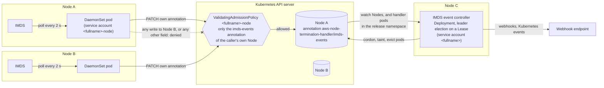
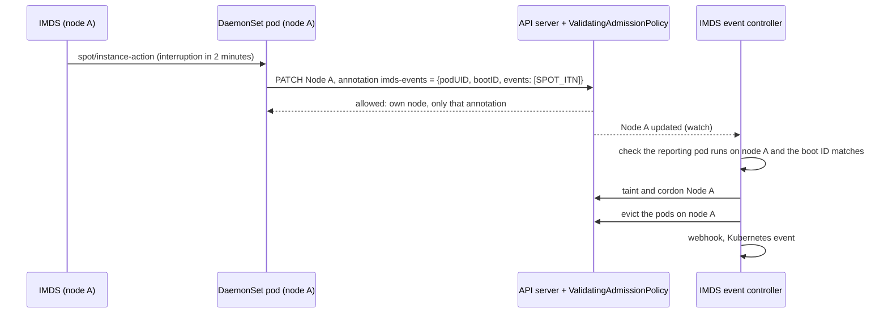

# IMDS event controller (IMDS mode)

Node Termination Handler (NTH) cordons and drains a node before its EC2 instance is interrupted, so it has to learn about interruptions as they are announced.
It has two modes for that: Queue Processor mode reads them from an SQS queue fed by Amazon EventBridge, and IMDS mode reads them from each instance's own [Instance Metadata Service](https://docs.aws.amazon.com/AWSEC2/latest/UserGuide/ec2-instance-metadata.html) (IMDS).
This page covers IMDS mode, where a DaemonSet pod on each node polls that node's IMDS for spot interruption notices, rebalance recommendations, scheduled maintenance events and ASG target lifecycle state changes, with no AWS infrastructure to set up.

Cordoning and draining needs permission to change Node objects and evict pods.
Kubernetes RBAC cannot limit a permission to the caller's own node, so when each DaemonSet pod drained its own node, every node ran a pod whose service account could cordon and drain every node in the cluster.

The IMDS event controller, on by default in the Helm chart, splits that work in two:

- **On each node,** the DaemonSet pod only writes its node's IMDS events to one annotation on its own Node object.
  A ValidatingAdmissionPolicy denies it every other write, so it has no permissions on other nodes.
- **A Deployment,** the IMDS event controller, reads those annotations and cordons, taints and drains the nodes, with the same settings and webhooks as before.

The events NTH handles, and how it drains a node, are unchanged.
It requires Kubernetes 1.30 or later.

- How the pieces fit together: [How it works](#how-it-works)
- What each component is allowed to do: [Permissions](#permissions)
- What's different from a DaemonSet that drains its own node: [Differences](#differences-from-the-daemonset-draining-its-own-node)
- Opting out: [Turning it off](#turning-it-off)

## How it works



The controller acts on a report only when the handler pod named in it is running on that node and the report's boot ID is the node's current boot ID.
For a spot interruption:



1. The DaemonSet polls IMDS as before.
   When it sees an event, it writes the event to the `aws-node-termination-handler/imds-events` annotation of its own Node object, and takes no other action.
2. The IMDS event controller, a Deployment, watches the Node objects.
   For each event in an annotation, it cordons, taints and drains the node with the same logic and settings the DaemonSet used, and runs the same webhooks.
3. The controller takes the node name, provider ID and instance ID from the Node object, never from the annotation, so a node can only report events for itself.
   It also takes the node's instance type, zone, region, IP addresses and hostnames, which webhooks and Kubernetes events include, from the Node object's labels and addresses that the cloud controller manager sets. The annotation only adds the account ID and instance life cycle, which the Node object doesn't have.

The controller replicas use leader election on a Lease named `<fullname>-imds-event-controller` in the release namespace; one replica handles events at a time.

## Permissions

| | DaemonSet (service account `<fullname>-node`) | IMDS event controller (service account `<fullname>`) |
|---|---|---|
| RBAC | `patch` on nodes; `create` and `patch` on events when `emitKubernetesEvents` is set | The NTH ClusterRole (cordon, drain and taint nodes, evict pods); `create`, `get` and `update` on its Lease; `list` and `watch` on pods in the release namespace |
| ValidatingAdmissionPolicy `<fullname>-node` | Only the `aws-node-termination-handler/imds-events` annotation of the node its pod runs on; only events about that node | None |
| AWS IAM | None: IMDS mode makes no AWS API calls | None |

RBAC cannot limit a permission to the caller's own node, so the DaemonSet's ClusterRole grants `patch` on every node, and the ValidatingAdmissionPolicy and its binding deny everything else.
The policy reads the node name from the `authentication.kubernetes.io/node-name` field that Kubernetes adds to service account tokens bound to a pod.
If the policy or its binding is deleted, the DaemonSet can patch every node again (it still cannot evict pods), so restrict who can change ValidatingAdmissionPolicies like other cluster-wide RBAC.

Only the controller sends webhooks, so the DaemonSet pods don't get the webhook settings: the URL, its Secret, headers, proxy and template.

The policy was tested against kube-apiserver v1.35.0 with service account tokens bound to a pod on `node-a`:

| Request with the DaemonSet's token | Result |
|---|---|
| Set, replace or remove the `aws-node-termination-handler/imds-events` annotation of `node-a` | Allowed |
| Set that annotation on `node-b` | Denied: `the handler on node node-a may only modify its own Node object, not node-b` |
| On `node-a`: change, add or remove another annotation; change a label; cordon; taint; add a finalizer; replace all annotations with a JSON patch; change the annotation and a label in one patch | Denied: `the handler may only change the aws-node-termination-handler/imds-events annotation of its own Node object` |
| Cordon `node-b` | Denied by the policy |
| Patch `node-a`'s status, delete a node, evict a pod | Denied by RBAC |
| Record an event about `node-a` / `node-b` | Allowed / denied: `the handler may only record events about its own node` |
| Any of the above with a token that is not bound to a pod | Denied: `the service account token is not bound to a pod on a node` |

## Requirements

- Kubernetes 1.30 or later.
  ValidatingAdmissionPolicy is GA in 1.30, and the node name in service account tokens (`ServiceAccountTokenPodNodeInfo`) is beta and on by default in 1.30, and GA in 1.32.
  The Helm chart fails to render on earlier versions.
- `rbac.create: true`: the policy is created with the RBAC resources.
- With `serviceAccount.create: false`, set `imdsEventController.nodeServiceAccount.name` to the service account of the DaemonSet.
  It must not be the controller's service account.

## The annotation

The DaemonSet writes the annotation when its events change, and replaces it with an empty report when it starts.
For example, with a spot interruption notice:

```json
{"bootID":"9b0e5c4e-8f63-4cbe-a0a6-2f1f2b3a8c7d","reporterPodUID":"5f0c3a61-2d0e-4c1a-9a57-7f7c2e1b9d40","nodeMetadata":{"accountId":"111122223333","instanceLifeCycle":"spot"},"events":[{"eventID":"spot-itn-5f2c0c3b4d0e9a8f13bfd5a78474f93e2a1a7f07b67a9225325197a0a9badf28","kind":"SPOT_ITN","monitor":"SPOT_ITN_MONITOR","startTime":"2026-10-30T23:47:34Z"}]}
```

The node writes the annotation itself, so the controller checks every field before it uses it, and the annotation carries no free text.
The controller drops an event with an unknown kind, an event ID that doesn't have the form the IMDS monitor of that kind writes, or an unknown scheduled event code or state, and empties an account ID that isn't 12 digits or an unknown instance life cycle.
It generates the description of each event the same way the IMDS monitor on the node does, from the event's kind and times; the description of a scheduled event leaves out the reason IMDS gives for it.

The controller ignores a report:

- whose `reporterPodUID` is not a running handler pod on the node: the DaemonSet no longer runs there (it was uninstalled, disabled, or its node selector changed), so nothing would update the report;
- whose `bootID` is not the node's current `status.nodeInfo.bootID`: it was written before the node rebooted.

Uninstalling the chart leaves the annotations on the Node objects; they are ignored, and `kubectl annotate nodes --all aws-node-termination-handler/imds-events-` removes them.
Events that IMDS reports as canceled or completed carry `"cancelled": true`; the controller uncordons the node only for an event it saw as active since it started.

## Differences from the DaemonSet draining its own node

- **Logs.** Cordon, drain, webhook and dry-run messages are in the controller's logs:

  ```bash
  kubectl -n kube-system logs -l app.kubernetes.io/component=imds-event-controller -c aws-node-termination-handler \
    --prefix --tail=-1
  ```

- **Metrics.** The node action counters (`actions_total`, for example `cordon-and-drain` and `pre-drain`) come from the controller, which takes the actions.
  The DaemonSet pods expose only the Go runtime metrics.
  With `podMonitor.create: true`, the PodMonitor selects the controller pods as well as the DaemonSet pods.
- **Event IDs.** Except for scheduled events, IMDS event IDs are hashes of the IMDS response, so two nodes interrupted at the same time report the same ID.
  The controller appends `-<8 hex digits>` derived from the node name to those IDs, and the suffixed ID appears in webhooks and logs.
  Taint values keep their 63-character limit, so long IDs lose the suffix there.
- **Node metadata in webhooks and Kubernetes events.** Webhooks and events carry the same metadata fields as before, with values from the Node object instead of from the node's IMDS: the instance ID from the provider ID, the instance type, zone and region from the `node.kubernetes.io/instance-type` and `topology.kubernetes.io/*` labels, and the private and public IP addresses and hostnames from the first address of each type in `status.addresses`.
  A field the cloud controller manager doesn't set is empty, such as the public IP address of a node in a private subnet, where IMDS may have had a value.
  Only the account ID and instance life cycle come from the node's report.
- **Event descriptions.** The controller generates the description of each event from the event's kind and times, as the DaemonSet does, so webhooks and events show the same text.
  The description of a scheduled event leaves out the reason IMDS gives for it, which the controller can't check: `system-reboot will occur between 2 Nov 2026 08:00:00 GMT and 2 Nov 2026 10:00:00 GMT`.
- **Uncordon after a scheduled reboot.** When NTH marks a node for uncordon after reboot, it also records the node's boot ID in the `aws-node-termination-handler/action-boot-id` label.
  The controller uncordons the node when its boot ID changes. `procUptimeFile` is not used.
  A node marked by an earlier NTH version has no boot ID label; the controller logs `Unable to complete the uncordon after reboot workflow` for it, and you uncordon it yourself.
- **One notice per kind.** A spot interruption, rebalance recommendation or ASG target lifecycle state notice ends the instance, so the DaemonSet reports only the first event of each of these kinds.
  Mock IMDS servers such as amazon-ec2-metadata-mock return a new interruption time on every request, which would otherwise add an event, and a drain, on every poll.
  Scheduled events carry their own IDs and are all reported.
- Not tested on Windows nodes.

## Turning it off

Set `imdsEventController.enabled: false`.
The DaemonSet then cordons and drains its node itself, with a service account that can cordon and drain every node in the cluster.

## Settings

| Flag | Environment variable | Default | Description |
|---|---|---|---|
| `--imds-event-reporting` | `IMDS_EVENT_REPORTING` | `false` | IMDS mode only. Write the node's IMDS events to its annotation and take no other action. The chart sets it on the DaemonSet. |
| `--enable-imds-event-controller` | `ENABLE_IMDS_EVENT_CONTROLLER` | `false` | Run the IMDS event controller. Cannot be combined with `--enable-sqs-termination-draining` or `--imds-event-reporting`. Requires `--pod-namespace` (`NAMESPACE`). |
| `--imds-event-controller-lease-name` | `IMDS_EVENT_CONTROLLER_LEASE_NAME` | `aws-node-termination-handler-imds-event-controller` | The Lease the controller replicas use for leader election. The chart sets `<fullname>-imds-event-controller`. |

The controller reads the same cordon and drain settings as the DaemonSet (`cordonOnly`, `taintNode`, `enableRebalanceDraining`, the grace periods, webhooks and so on).
The IMDS settings (`enableSpotInterruptionDraining`, `enableScheduledEventDraining`, `enableRebalanceMonitoring`, `enableASGLifecycleDraining`, `instanceMetadataURL`) apply to the DaemonSet.
